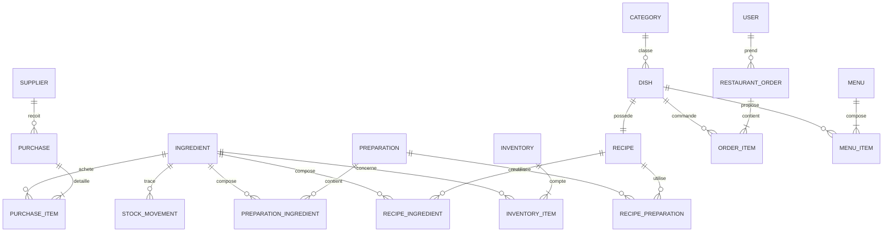

# Modèle de données — synthèse

Le modèle sépare le catalogue commercial (plats et menus), la composition matière (recettes et préparations), les approvisionnements (fournisseurs et achats), le stock (mouvements et inventaires) et l'activité de salle (commandes et lignes).

Les détails, attributs, cardinalités et contraintes figurent dans [MCD.md](MCD.md) et [MLD.md](MLD.md).
