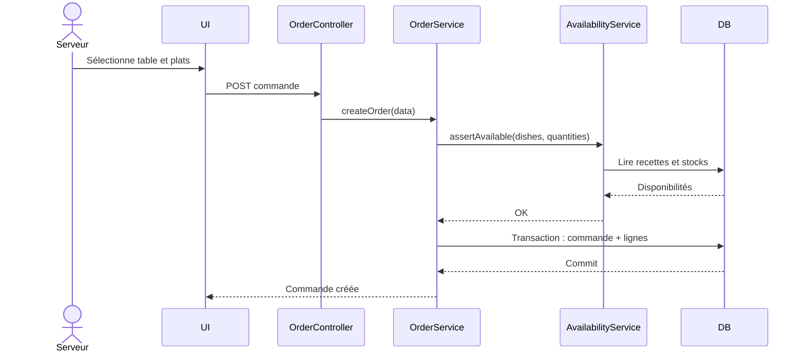
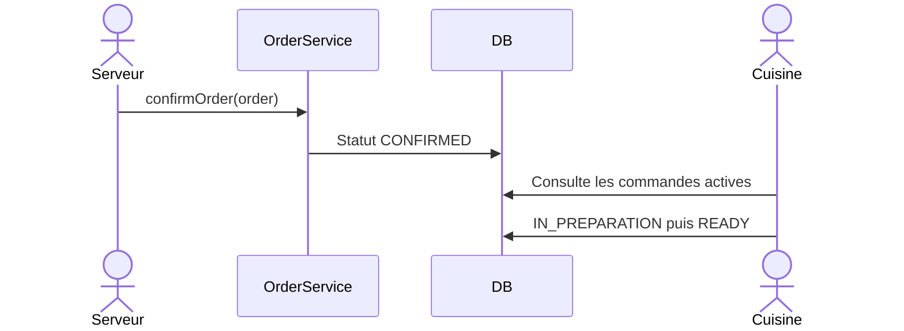
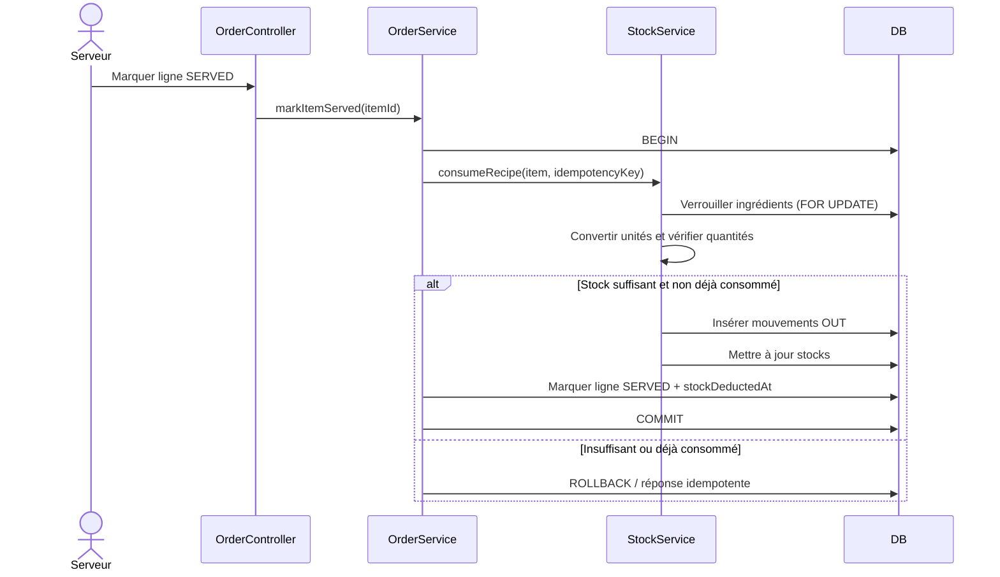
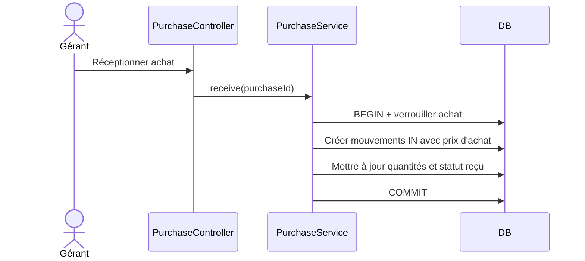

# Diagrammes de séquence

## Création et transmission d'une commande

## Transmission et préparation en cuisine

## Validation du plat servi et décrémentation

## Réapprovisionnement d'un ingrédient

